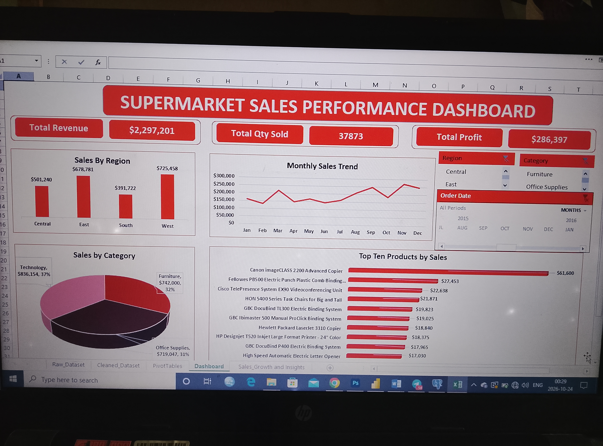

## 📊 Superstore Sales Performance Dashboard

## 📌 Project Overview

This project involves analyzing Superstore sales data using Microsoft Excel to evaluate sales performance, profitability, regional performance, product categories, and monthly sales trends.

The goal is to transform raw data into actionable business insights through an interactive dashboard that supports data-driven decision-making.

---

## 🎯 Project Objectives

- Analyze overall sales and profit performance.
- Identify the best-performing and lowest-performing regions.
- Evaluate sales and profit across product categories.
- Analyze monthly sales trends.
- Compare product performance based on revenue.
- Present insights through an interactive Excel dashboard.

---

## 🛠️ Tools and Techniques

- Microsoft Excel
- Data Cleaning and Formatting
- PivotTables and PivotCharts
- Data Visualization
- Sales and Profit Analysis
- Monthly Trend Analysis
- Month-over-Month (MoM) Analysis
- Interactive Dashboard Design

---

## 📂 Dataset Description

The dataset contains approximately 9,994 sales records, including information on sales, products, regions, order dates, quantities, and profits.

---

## 📈 Key Performance Indicators (KPIs)

Metric| Value
Total Revenue| $2,297,200.86
Total Units Sold| 37,873
Total Profit| $286,397.02

---

## 🔍 Key Business Insights

**- Regional Performance:** The West region recorded the highest revenue, while the South region recorded the lowest.

**- Monthly Sales Trends:** November recorded the highest monthly sales, while February recorded the lowest.

**- Category Performance:** Technology generated the highest revenue and profit among the product categories.

**- Product Performance:** Products were compared based on their revenue contributions.

---

## ⚙️ Project Workflow

**1. Data Preparation:** Cleaned and formatted the dataset for analysis.

**2. Data Analysis:** Used PivotTables to summarize sales, profit, quantity, and category performance.

**3. Trend Analysis:** Examined monthly sales patterns and month-over-month changes.

**4. Data Visualization:** Created charts to communicate key findings.

**5. Dashboard Development:** Combined KPIs and visualizations into an interactive Excel dashboard.

---

## 🖥️ Dashboard Preview

---

## 📁 Project Files

- "Superstore_Sales_Performance_Dashboard.xlsx" — Excel workbook containing the analysis and dashboard.
- "IMG_20261024_083006.jpg" — Dashboard preview image.
- "README.md" — Project documentation.

---

## 💡 Business Value

This project demonstrates the use of Excel for transforming raw data into meaningful business insights. The dashboard helps users monitor performance indicators, identify sales trends, compare regional performance, and evaluate product category performance to support informed business decisions.

---

## 👩‍💻 Author

Dike Vivian Chinelo

Data Analyst, Statistician 

Technical Skills: Excel | SQL | Power BI | SPSS | Python (Currently Learning)

---
